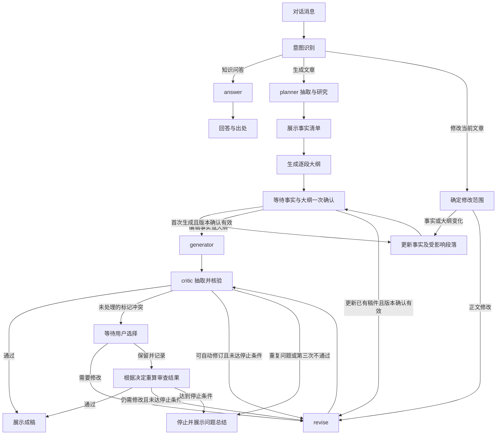

# Forge 全量重构方案

状态：已批准并完成首版全量重构。
日期：2026-09-25。
依据：hugo 本轮逐项确认的需求；未单独说明的问题采用当轮推荐答案。
最新修订：向量检索统一使用 PostgreSQL + pgvector；预留 LangGraph Server、Gateway、RocketMQ 的显式扩展位置。

## 1. 目标与范围

重建以对话为入口的文章生产和公司知识问答系统，解决目前编排、节点执行、状态和页面流程分散的问题。

- 重构前端、后端接口、graph、agent runtime、运行时 skill、数据模型、权限、知识导入和可观测性。
- 不要求迁移旧文章、旧对话、旧知识数据和运行中的旧任务，不实现兼容层。重新从公开资料建立公司知识库。
- 代码层旧实现已按删除清单移除；本地密钥、数据库卷和用户数据仍按边界保留。
- “完全重构”指新架构完整替换旧运行实现，不是先清空仓库。按功能建立替换清单，新功能通过验收后移除对应旧模块、过时测试、依赖和部署配置；最终只有新主流程，不保留旧实现回退分支。
- 保留 Git 历史、当前批准的设计和项目指令。工作区未提交内容先辨认归属，不顺手删除；旧资料可作为只读实现参考，不要求迁移至新版产品。
- 员工复制粘贴原文；默认沿用原文主题和文章方向。抓取平台登录、自动发布、视频和音频生成不属于新主流程。
- 一段对话最多绑定一篇文章，也允许从纯知识问答开始，之后提供文章。切换到另一篇文章需要新建对话。
- 文章处理中可插入知识问答；问答不自动修改文章。
- 事实清单、逐段大纲、稿件与问题报告都在同一对话工作区呈现。

## 2. 已确认的产品规则

### 2.1 研究与写作

planner 从原文抽取事实，分析需要补充的公司信息，加载 text2sql skill 查询公司数据库；每篇文章必须尝试 Tavily 研究。结合整体事实和原文方向做向量召回，补充历史公司文档中相关内容。

先展示事实清单，再生成逐段大纲。每段必须包含主要内容和使用的事实 ID。事实与大纲一致后，用户一次确认，才能进入 generator。

用户修改事实时更新受影响的大纲段落；确认必须绑定事实版本和大纲版本。任何版本变化使旧确认失效。

### 2.2 用户标记事实

- 用户新增、修改、明确要求保留的事实，以及已知冲突事实，带标记。普通查看和搜索不会改变标记。
- 用户删除事实表示当前文章排除该事实，保存排除记录；planner 和 critic 不能自动复活语义相同的事实。
- 用户新增事实通过 skill 检索核对；用户修改事实同样核对修改后的内容。
- 查询成功但未找到证据：允许使用，保留“无来源／未核验”状态。
- 查到冲突：展示事实、证据及比较理由，让用户选择采用哪一个、修改或排除。
- 用户决定连同事实版本、冲突内容和依据一起记录；同一事实版本的已处理冲突不再重复询问。
- 内容改变形成新事实版本，旧决定不得自动授权不同内容。保留历史决定便于理解变更。
- 业务事实是否采用由用户决定；用户决定不能扩大访问权限或将无来源事实转换成“已核验”。

### 2.3 critic 和 revise

critic 从生成正文重新抽取事实，使用同一 skill 查询数据库，与写作前确认的事实清单及当前有效清单比对。

- 非标记事实：critic 给出证据和修改要求，revise 自动修改，再交 critic 复查。
- 标记事实：新的未处理冲突交用户选择；已经决定保留的对应问题不再次询问。
- 正文新增事实经数据库查证属实，可自动补入当前文章清单，附来源及“写作后新增”记录；写作前基准清单不可覆盖。
- 无法查证的非标记新增事实，交 revise 删除或改写；查询失败不能当作无法查证。
- critic 同时检查大纲落实、方向、业务和法律口径、表达、重复内容及明确的平台要求。
- 成稿后修改事实，先展示受影响段落；用户选择“按变更更新文章”，再执行定向 revise 和 critic。

### 2.4 停止规则

一次生成或明确发起的修改任务中，critic 累计三次给出“不通过”即停止。初稿的第一次 critic 不通过就计数，因此最多有两次自动修订机会。

同一实质问题在一次针对性修订后再次出现，提前停止。问题标识结合规则、事实或段落对象、规范化问题类型，不直接比较问题描述字符串。

critic 执行失败、工具故障、等待人工决定不算有效“不通过”。停止后保留稿件，展示问题、证据、尝试过的修订和失败原因；由用户明确发起继续处理或接受当前稿件。接受稿件不抹掉问题记录。

## 3. Runtime 设计

### 3.1 技术与部署提案

业务后端沿用 Python/FastAPI 技术方向；LangGraph 负责工作流与持久化执行，节点内部需要工具循环时采用 LangChain create_agent；模型通过统一配置接入，当前 Qwen 路径在实施前验证工具调用和结构化输出能力，选定并锁定依赖版本。

前端建议独立 TypeScript 应用，采用 React 构建对话和文章工作区。PostgreSQL 保存业务数据、任务、审批、审计、checkpoint、文档块及向量；使用 pgvector 扩展执行向量相似度检索。不使用 Milvus，新版依赖和部署配置移除其相关内容。

初版部署采用前端、FastAPI、工作流 worker、带 pgvector 的 PostgreSQL。worker 通过工作流执行 Interface 在进程内运行编译后的 graph；初版不启用独立 LangGraph Server、Gateway 和 RocketMQ，但按第 3.5 节预留相应 Interface、装配位置与执行契约。后续通过新增 Adapter 接入，不改写文章业务规则或保留旧版兼容代码。

任务进入 PostgreSQL 持久化队列；worker 使用事务认领、租约和递增执行令牌。过期 worker 不得提交结果，同一文章只允许一个修改执行。checkpoint 只由 LangGraph 管理，业务稿件版本只由文章模块管理，通过稳定任务 ID 和版本引用关联，避免双向覆盖。

### 3.2 模块与 Interface

模块以调用方需要的能力划分，每个 Interface 同时约定输入、结果、权限、失败模式和版本约束。

| Module | 对外 Interface | 内部 Implementation |
|---|---|---|
| 对话与文章 | 提交消息、读取工作区、编辑事实、确认版本、提交冲突决定 | 意图路由、文章绑定、版本校验、事件发布 |
| 工作流 | 提交动作、读取执行状态、恢复或取消 | graph、任务租约、checkpoint、幂等与恢复 |
| 证据研究 | 按任务获取证据包 | skill 加载、SQL、Tavily、向量召回、证据归一化及冲突分析 |
| 事实清单 | 应用事实变更、生成确认快照、比较稿件事实 | 标记、排除、事实身份、来源、决定记录 |
| 知识管理 | 导入资料、发布资料、撤销资料 | 文档处理、组织建模、版本及索引维护 |
| 授权 | 生成与验证本次访问范围 | 身份、角色、文档与数据授权、撤权 |

证据研究 Interface 返回证据、来源、访问范围、完成状态和缺口。调用方不需自行拼接 SQL、加载 Markdown 或解释工具异常。

### 3.3 节点执行

| 节点 | 输入 | 输出与能力 |
|---|---|---|
| intent | 用户消息、当前阶段、文章引用 | 生成／修改／问答／澄清；普通意图不改变任务状态 |
| planner | 原文、方向、授权范围、用户约束 | 原文事实、公司补充事实、来源、冲突；可调用三类检索 |
| outline | 当前事实清单、方向 | 每段目的、主要内容、fact_ids；属于规划阶段 |
| generator | 已确认事实和大纲快照 | 分段正文、事实引用映射；不能改确认快照 |
| critic | 正文、基准与当前事实、用户决定 | 稿件事实清单、证据、问题、通过状态；可研究核验 |
| revise | 正文、问题清单、允许采用的事实和用户决定 | 新稿件版本、修改记录 |
| answer | 问题、授权知识范围、当前文章只读上下文 | 带出处的回答；可查询 skill、向量库和 Tavily |

上下文按节点裁剪。planner、critic 和 answer 共用研究模块，但有各自的任务目标和输出模型。意图分类、大纲结构验证、版本检查等不必引入自主工具循环。

每次 agent 执行设置模型调用次数、工具次数、总时间和上下文预算；具体数值配置化，不能存在无限循环。框架重试和应用重试由同一策略统筹，避免倍增。

### 3.4 状态与恢复

- 登录身份和权限由服务端注入，不能来自模型输出。恢复时重新授权。
- graph state 保存原文引用、事实及大纲版本、稿件引用、轮次、待决定项、结果摘要；完整文档与历史产物按 ID 读取。
- 事实清单、证据引用、用户决定、稿件版本为结构化持久化数据，不能只存在聊天消息里。
- 进入等待阶段后释放 worker；用户动作触发带版本的恢复命令。
- checkpoint 采用可恢复的节点和研究子步骤粒度；外部调用可能在故障后重试，不宣称全局 exactly-once。
- 写稿、事实变更和发布事件以幂等键落库；模型及检索完成结果按执行步骤 ID 保存，恢复优先使用已完成结果。
- 同一文章的修改串行；知识问答可读取一个稳定快照并行执行，不写入文章状态。
- 取消操作保留已经完成的结果，不再提交晚到的过期输出。

### 3.5 调度与部署扩展位置

以下扩展由用户明确要求。初版实现本地 Adapter 和 Interface 契约，不提前构建没有部署需求的远程实现，也不以空壳远程类制造已完成的假象。

| 扩展位置 | Interface 与共同契约 | 初版 Adapter | 未来 Adapter |
|---|---|---|---|
| 工作流执行 | WorkflowExecutor：启动、读取状态、恢复、取消；统一输入动作、结果、暂停与错误语义 | 进程内 LangGraph 执行 | LangGraph Server 客户端 |
| 任务派发 | JobDispatcher：发布稳定 job_id 对应的执行通知；认领、重投、确认与死信策略明确 | PostgreSQL 队列轮询与认领 | RocketMQ 通知发布与消费 |
| 请求入口 | ApplicationCommands：提交消息、确认、修改和查询；携带认证主体、幂等键、版本与关联 ID | FastAPI 直接调用 | 独立 Gateway 转发到应用入口 |

业务模块依赖上述 Interface，由启动装配统一选择 Adapter。SDK 导入、远程地址和队列配置集中在各自 Adapter，graph 节点不得直接调用 RocketMQ 或 Gateway。

扩展时必须遵守：

- Gateway 负责入口认证校验、限流和路由；应用仍独立验证可信身份和访问范围，不信任任意客户端身份头。
- PostgreSQL 保留业务任务和产物的事实来源；RocketMQ 承载执行通知，不成为第二套业务状态。启用时通过事务 outbox 可靠发布，重复投递使用同一 job_id 去重。
- 同一环境只启用一个派发所有者；迁移时暂停认领并排空或重新归属待处理任务，禁止 PostgreSQL 轮询器与 RocketMQ 消费者无协调地重复启动。
- 每个工作流只有一个执行及 checkpoint 所有者：本地模式由本地 runtime 管理，远程模式由 Server runtime 管理。应用不得同时在两处编译执行同一 thread。
- 本地到远程切换需要独立切换方案，包括在途任务、checkpoint 可用性、权限重验与旧执行令牌失效；预留 Interface 不等于承诺任意运行中任务无缝切换。
- 统一 job_id、conversation_id、article_id、run_id、审批版本、事件序号和幂等语义；远程断线和消息重投不能重复生成稿件。
- 初版契约测试覆盖启动、暂停、恢复、取消、重复消息、过期审批和租约失效；未来新增 Adapter 必须通过同一套测试，并补充真实远程故障测试。

## 4. Graph 与页面状态

图中的事实编辑、大纲编辑和冲突决定也可来自卡片操作，作为显式动作提交，不重新交给模型猜测意图。

文章阶段为：研究中、规划中、待确认、生成中、审查中、待用户决定、修订中、可定稿、已定稿、需人工处理、失败、已取消。知识问答拥有独立执行状态。

页面采用单一对话工作区：对话输入上方持续提供事实清单和大纲面板；稿件在同一工作区展示，可收起面板但不因进入写作阶段销毁清单。

事实卡片显示原文／公司补充／用户添加／正文新增类别、正文、出处、核验状态、用户标记、冲突、关联段落，提供新增、编辑、删除和搜索。删除保留可追溯记录。

进度展示真实事件，如“已抽取事实”“正在检索公司资料”“第 2 次审查”；不展示模型隐式推理。编辑期间使旧确认按钮失效，只有对应版本完成大纲更新后才能确认。

客户端通过 HTTP 提交动作、SSE 接收带序号事件；断线后按游标续读或重新获取快照。浏览器断线不取消后台任务。重复点击依靠幂等键去重。

## 5. Text2SQL Skill 与检索

### 5.1 Skill 内容

运行时 skill 包含入口说明、组织关系口径、业务口径、法律口径及法规原文地址、获准查询的表和字段、常见查询示例。它属于 Forge 业务 runtime，不是开发代理的 SKILL.md。

先加载获授权的技能目录和摘要，再按实体、业务及法律问题加载相应 Markdown 与 schema。每条事实都能进入 skill 核验流程，但同一批中相同实体、相同查询可复用已授权结果，避免每条事实重复加载全量文件。

skill 的内容版本随执行记录保存。公司内部 Markdown 必须按资料权限加载，不能因为位于技能目录就对访客开放。

### 5.2 SQL 执行约束

执行顺序：服务端身份 → 数据范围 → 获授权 schema → 模型提出 SQL → 语法树与语义约束检查 → 数据库执行 → 结果范围复核 → 证据输出。

- 使用专用受限只读数据库角色和只读事务；业务写入连接不进入工具进程可访问配置。
- 单条 SELECT／允许的只读 CTE；递归检查子查询和 CTE，禁止写操作、DDL、COPY、多语句、锁定读和未授权 schema。
- 函数、操作符和对象按允许清单控制，阻止有副作用函数、文件访问、网络访问、扩展调用和危险系统目录访问；SELECT 关键字不是只读证明。
- 结合数据库行级权限或受控视图约束数据范围，强制行级权限且查询账号无绕过权限。模型自行附加 owner_id 过滤不构成授权。
- 设置查询超时、结果上限、资源限制；参数化值，标识符对照授权目录检查。
- 无权限、语法拒绝不可降级绕过；工具不具备文件任意读取、终端执行、安装依赖或写数据库能力。

只读限制针对 agent skill；文章保存、事实编辑、用户决定及知识导入由独立的受授权业务写入路径处理。

### 5.3 向量召回

以完整事实清单和文章方向形成检索计划：保留整体查询，再按组织、业务和事实主题拆成若干查询，避免简单拼接造成超长截断。原文引用和独立事实身份保留，不用摘要替代事实证据。

在授权范围内召回文档块，去重、排序并按需读取相邻块；结果带文档版本、段落位置、来源及原有事实状态。召回相似不等于事实得到证实。

文档块、embedding 与授权元数据保存在 PostgreSQL，通过 pgvector 计算相似度。查询必须包含知识空间及资料可见范围，并由数据库行级权限或受控视图强制限制；在向模型提供正文前按最新授权再次检查。缓存按用户、权限范围、版本隔离；撤权后禁止使用旧缓存或 checkpoint 中残留的正文继续回答。

embedding 记录模型标识、版本、维度与 chunk 版本；不同模型或维度的向量不得混在同一次相似度比较中。更换 embedding 模型时重建对应索引，并明确切换版本，不能静默混用。

首批数据先验证带权限过滤的精确检索基线，再按数据量和性能要求启用余弦距离 HNSW 索引。近似索引的过滤可能导致返回不足，应使用经过测试的迭代扫描、分区或授权范围内的精确检索；不能通过放宽权限补足结果。具体 pgvector 版本和 embedding 维度在实施前验证，检查索引支持的维度限制。参见 [pgvector 官方文档](https://github.com/pgvector/pgvector#filtering)。

### 5.4 可信度与冲突

用户确认的默认来源等级为数据库＝skill Markdown＝历史公司文档，高于普通 Tavily 检索材料。Tavily 作为渠道，其命中的原始官方文件按实际出处评价，不能固定低于过期内部材料。

比较原始出处权威性、适用主体、时间、地区、指标口径、直接支持程度和独立性。相同来源的转载不算多份独立证据。

只有证据明确占优才自动采用；模型给出的置信度数字不能单独决定胜负。接近或不可比较的证据交给用户。用户标记事实发生未处理冲突时，无论自动分析结果如何都展示选择。

## 6. 数据模型

所有私有数据明确归属知识空间、租户或用户；数据库标识、公开组织实体和登录租户不是同一个概念。

| 数据组 | 建议记录与关键内容 |
|---|---|
| 身份授权 | users、tenants、memberships、roles、resource_grants；访客身份、员工角色与资料权限 |
| 知识空间 | knowledge_spaces：公共、公司内部、个人；个人空间 owner_id |
| 组织 | organizations：法定名、类型、地区、公开标识；organization_aliases：别名、范围、有效期 |
| 组织关系 | organization_relations：主体与客体 ID、关系类型、有效期、证据；股权关系与官网列示关联分开 |
| 业务和资质 | business_offerings、organization_businesses、qualifications：所属实体、描述、证号、适用范围、有效期、来源 |
| 口径与法规 | knowledge_resources：Markdown 版本、分类、权限；legal_references：官方出处、适用地区、效力与时间信息 |
| 文档与证据 | documents、document_versions、chunks、chunk_embeddings、evidence：来源 URL、获取时间、原始片段、位置、内容校验值；pgvector 向量及模型、维度、版本 |
| 对话与文章 | conversations、messages、articles、article_versions：一对话最多一文章；方向、阶段与稿件版本 |
| 事实 | article_facts、fact_versions、fact_evidence：命题、实体、关系、值、单位、限定、状态、用户标记、排除记录 |
| 规划与决定 | outline_versions、outline_sections、approval_snapshots、user_decisions：fact_ids、确认版本及冲突处理 |
| 执行与审查 | jobs、run_steps、review_reports、review_issues、events、audit_records：租约、轮次、问题身份、重试与来源 |

原始来源证据、模型抽取候选、文章选用事实分别保存。文章事实 CRUD 不更新公共或公司知识库。

个人历史默认保存对话；上传资料和明确“定稿”的文章及其证据版本进入个人向量检索。草稿和普通问答不自动变成知识来源。用户标记及无来源状态随历史内容保留。

## 7. 身份与资料管理

访客可访问公共资料及自己的个人空间；员工另可访问获授权的公司资料。员工之间不默认互读个人空间。

实施提案：初版采用应用内账号登录，管理员邀请员工并分配角色、部门和资料范围；访客注册后获得独立账号与个人空间。暂不假设已有企业 SSO 接口，不按自报邮箱或对话声明自动授予员工权限。

公司资料和 skill 的发布采用独立管理操作；日常使用者在对话内完成工作，管理者也可从对话触发结构化导入与授权表单。个人资料管理允许上传、查看和删除，删除后撤销检索可见性并更新索引。

日志不记录凭据、完整敏感查询结果或任意个人资料正文；记录执行身份、动作、耗时、结果数量、资料 ID、拒绝原因及可控脱敏诊断信息。

## 8. 首批公司知识建设

核心来源：https://www.nnngu.com/ 。官网旗下机构页列示“锐博天成集团股份有限公司（集团总部）”，并提供分支及关联机构名单。

初始化流程为：官网集团概况、旗下机构分页、业务页和资质线索 → 原始资料归档 → 实体与别名归一 → 关系与业务候选 → 来源核对 → 发布公共知识与索引。

- 官网列示关联可记录为“官网旗下机构”，不推断持股比例或完整股权链。
- 集团宣传资质不能自动归到每个子公司；证书需要具体主体及有效性证据。
- 规模、营收和员工数量记录出处与采集时间；未提供统计期时标记未知，不将采集时间冒充数据统计期。
- 法律口径保存官方法规出处及适用时间和地区；与内部业务说明分开。
- 对公开资料无法覆盖的主体和资质形成待补充清单，不以想象填充真实数据。
- 允许在表结构、关系类别和交互设计上补充方案；演示数据独立标记并与真实库隔离。

## 9. 失败、降级与观测

| 失败类型 | 行为 |
|---|---|
| Tavily／向量检索临时失败 | 有限重试；使用已有获授权证据，显示未完成项；每篇文章仍记录联网尝试 |
| SQL 查询成功但为空 | 对用户事实按无来源规则允许使用；保存空结果状态 |
| SQL 查询超时或不可用 | 可参考获授权的 Markdown／历史文档；标记数据库核验未完成，不当作无冲突 |
| 模型超时／格式错误 | 按统一预算重试，失败保留步骤与已完成产物；不伪造输出 |
| 权限／语法树拒绝 | 拒绝动作并审计，不扩大权限或改走旁路 |
| 缺事实或大纲 | 不进入 generator；提示缺少的产物 |
| critic 核验依赖失败 | 报告不完整，不记作通过，也不计入有效不通过次数；必要时等待重试或用户处理 |
| critic 三次不通过或重复问题 | 停止自动修订，展示当前稿件和问题总结 |

有效重试针对可恢复错误；参数错误、权限错误不反复重试。日志关联 conversation_id、article_id、run_id、step_id、工具调用 ID 和产物版本。

页面展示模型／检索／数据库失败的可操作摘要；详细异常进入受限日志。度量包括阶段耗时、模型与工具调用数、token 使用、降级率、审查不通过次数、人工冲突数和恢复成功率。

## 10. 实施顺序与验收

批准整体方案后分批实现，每批交付可运行的纵向流程；不维持新旧两套运行路径。

1. 建立模块结构、身份授权、数据模型、任务与事件、graph 持久化及三处扩展 Interface；交付本地 Adapter，验证一对话一文章、断点恢复和执行契约。
2. 建立 PostgreSQL + pgvector 文档检索、公司资料导入及只读 skill，验证 SQL、向量和 Markdown 权限一致；导入首批有来源的组织数据。
3. 实现 planner、事实 CRUD、逐段大纲和版本确认，形成可交互的对话工作区。
4. 实现 generator、critic、revise、标记冲突决定及停止规则，打通完整文章流程。
5. 完成知识问答、个人历史检索、降级、审计和端到端验收；依据替换清单退役旧实现、旧测试和旧部署配置，移除 Milvus 依赖；保留未来远程 Adapter 的 Interface 和契约测试。

旧模块去向记录在 `docs/2026-09-25-legacy-removal-map.md`。首版已用新的 domain、application、workflow、knowledge、infrastructure、API 和 React 工作区替换旧主流程。

### 边缘情况与测试用例

| 场景 | 必须验证的结果 |
|---|---|
| 空原文、超长原文、多个公司同名 | 空输入追问；超长分块保留出处；同名不错误合并 |
| 员工贴入另一篇原文 | 提示新建对话，不覆盖当前文章 |
| 用户新增事实，查询成功无结果 | 可使用并标记无来源；不生成伪造引用 |
| 用户新增事实，数据库故障 | 显示核验未完成，不能沿用“空结果通过”路径 |
| 用户标记事实冲突并选择保留 | 保留决定；同事实版本复查不重复询问 |
| 删除事实后再次召回 | 不自动重新加入，也不通过正文新增路径恢复 |
| generator 新增可核验事实 | 自动加入当前清单；基准快照不变；来源可追踪 |
| 编辑事实同时点击确认 | 旧版本确认被拒绝，不能生成过期稿件 |
| 两个浏览器同时修改 | 一个版本成功，另一个获得冲突提示，不静默覆盖 |
| 第一次、第二次、第三次 critic 不通过 | 第三次立即停止；计数包含初稿审查 |
| 同问题修订后重复、描述不同 | 按实质问题识别重复并停止 |
| 工具错误或等待人工 | 不增加 critic 不通过计数 |
| worker 崩溃、租约过期、重复提交 | 恢复完成步骤；晚到输出不能覆盖新版本；无重复稿件写入 |
| 跨访客、跨员工、个人资料访问 | SQL、向量、Markdown、缓存和引用均不泄漏 |
| SELECT 中的副作用函数、写 CTE、多语句 | AST／允许清单和数据库权限均拒绝 |
| 暂停期间撤销员工权限 | 恢复时重新授权，不再向模型或页面提供被撤销内容 |
| SSE 断线与重连 | 工作继续；恢复事件或快照，无重复操作 |
| 问答插入文章生成 | 回答带出处，文章状态与稿件版本不被修改 |
| 历史文章含用户无来源事实 | 召回保留状态，不能因入库就升级为已核验 |
| pgvector 与全文查询使用同一私有文档 | 两种路径的可见范围一致，拒绝跨账号或跨空间读取 |
| 近似向量检索经权限过滤返回不足 | 使用受限扫描或精确检索处理，不降低授权要求 |
| embedding 模型或维度改变 | 不混合比较，切换前完成对应索引建设与验证 |
| 重复派发、过期执行者、远程执行状态不确定 | 契约保持任务唯一性和产物版本，不能直接启动第二份执行 |
| 新版干净环境启动 | 只需已声明依赖和带 pgvector 的 PostgreSQL，不依赖旧目录、Milvus 或未启用的远程调度 |

测试以模块 Interface 和真实授权执行路径为主；权限和 SQL 检查使用隔离的真实 PostgreSQL，向量过滤进行跨账号集成测试，graph 使用可控模型和工具结果验证状态与恢复。真实模型验收采用固定文章集，人工检查事实引用、段落落实和修订结果，不仅用模拟输出证明质量。

## 11. 审阅要点与资料依据

产品规则来自本次对话。向量方案已按用户要求确定为 PostgreSQL + pgvector。实施提案包括：初版 LangGraph worker 直接执行、统一节点内 agent runtime、应用内邀请账号、React 对话工作区、PostgreSQL 持久化任务；LangGraph Server、Gateway 和 RocketMQ 通过显式 Interface 留好后续扩展位置。具体依赖版本和执行预算在实施前验证并锁定。

当前仓库事实依据：langgraph.json 指向 server_graph.py；graph_hil.py 是运行主图；reflection_writer.py 内部已有 planning/generator/critic/reviser；generator_agent.py 是自建动作循环；fact_governance 的迁移定义不代表其已接入生产流程。

外部依据：

- LangChain agent 循环及结构化输出：https://docs.langchain.com/oss/python/langchain/agents
- LangGraph 持久化：https://docs.langchain.com/oss/python/langgraph/persistence
- pgvector 向量检索、过滤与索引：https://github.com/pgvector/pgvector
- 锐博集团官网集团概况：https://www.nnngu.com/groupprofile.html
- 锐博集团官网旗下机构：https://www.nnngu.com/framework.html

实现已落地并通过单元测试、Python 编译、前端类型检查与生产构建、Compose 配置检查和 PostgreSQL SQL 语法解析。Docker 中的 PostgreSQL 17 + pgvector 已完成真实集成验收，包括迁移、RLS 跨账号隔离、只读 Text2SQL 角色、向量检索权限过滤、LangGraph PostgreSQL 检查点和 API 关键流程。
