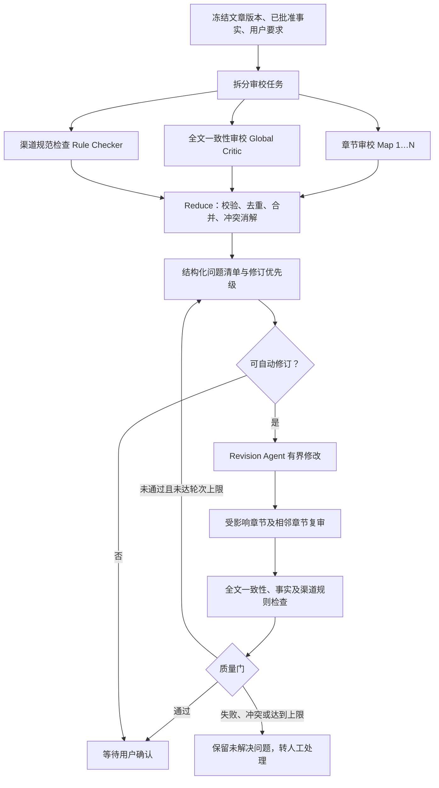

# 文章并行审校与有界修订方案（备份）

> 状态：待实施。记录日期：2026-09-22。本文件仅保存方案，当前代码未按此方案改动。

## 目标

对一个确定的文章版本，依据已批准的事实清单、用户要求、批准的大纲和目标渠道，并行完成章节局部审校、全文一致性审校和渠道规范检查。将各路结果归并为可追踪的问题清单，交由现有 Revision Agent 有界修改；随后复审受影响范围和全文。审校失败、事实冲突或超出修订预算时，保留问题并转人工处理。



## 现有代码基础与接入位置

当前 `forge/agents/reflection_writer.py` 已实现 `planning → generator → critic → reviser` 子图、事实抽取与匹配、确定性检查，以及最多两轮自动修订。`forge/agents/revision_agent.py` 已实现章节范围约束、修订任务优先级、动作日志与每轮最多 8 个工具动作。`forge/deep_mode/graph_hil.py` 的 `reflection_node` 生成草稿后进入人工内容审核；`tuning_node` 在用户微调后再次调用 Critic。

建议在现有 `critic_node` 所在位置接入新的审校模块，并让 `tuning_node` 调用同一模块。保留现有 Revision Agent 作为唯一自动修改入口。这样生成后的自动审校和用户微调后的复审使用同一套问题结构和质量门。

建议涉及的文件与职责：

| 位置 | 计划变更 |
|---|---|
| `forge/agents/reflection_writer.py` | 将现有单次全文 Critic 的编排改为调用统一审校模块；保留子图路由和修订轮次控制 |
| `forge/agents/research_types.py` | 增加文章快照、审校问题与报告的结构化类型 |
| `forge/agents/revision_agent.py` | 接收 Reduce 后的可执行问题；保留章节边界和动作上限 |
| `forge/deep_mode/graph_hil.py` | 微调后复用审校模块；定稿入口增加文章版本与质量报告校验 |
| `forge/web/templates/index.html` | 在现有内容审核页面展示问题、证据、优先级和未解决原因 |
| `forge/observability/metrics.py` | 增加审校耗时、模型调用、超时与问题数量指标 |

具体新增模块名称在实施时确定。模块只向调用方暴露一个主要接口，内部封装任务拆分、并发、结果验证与 Reduce：

```python
async def review_article(
    snapshot: ArticleReviewSnapshot,
    *,
    changed_section_ids: set[str] | None = None,
) -> ReviewReport:
    ...
```

## 数据契约

`ArticleReviewSnapshot` 是本轮审校的只读输入，应包含文章版本哈希、章节 ID 与内容哈希、已批准事实及证据、用户要求、批准大纲、目标渠道和参考文章约束。所有并行审校任务读取同一快照；审校任务不直接修改草稿、事实注册表或 LangGraph 状态。

现有 `ReflectionIssue` 只有问题类型、严重度、原文片段、事实 ID 与修改指令。为支持并行 Reduce 和跨版本复审，计划增加：

- `section_id`：问题定位；全文问题可为空。
- `source_checker`：章节、全文、渠道规则或确定性事实检查。
- `evidence_ids`：支持判断的证据 ID；没有证据的断言必须明确标注。
- `priority`：修订顺序。
- `issue_key`：跨版本识别同一问题的稳定指纹。
- `draft_version_hash`：问题对应的文章版本。
- `review_status`：未解决、已解决、冲突、需人工处理等状态。

每轮可重新生成展示用 `issue_id`，但不能只靠 `I001` 这类序号判断跨版本的问题是否解决。`ReviewReport` 应记录审校是否完整、各检查器状态、归并后的问题、评分、是否允许自动修订，以及阻塞原因。报告与版本哈希一起保存到现有 `quality_report`，避免旧报告批准新版本文章。

## 三路审校

1. **章节 Map**：按照现有 `GenerationSection.section_id` 拆分，检查章节目标、指定事实、证据、局部论证、字数和表达。每个任务只接收该章节及必要的上下文，不重复输入整篇长文。
2. **Global Critic**：复用现有全文提示词与检查逻辑，检查观点、术语、结论、前后称谓、跨章重复、章节承接和整体结构。
3. **Rule Checker**：确定性代码检查字数、标题、禁用表达、明确的用户要求及渠道硬规则；无法用确定性代码判断的表达要求再交给模型。

事实抽取与匹配应尽量复用现有逻辑，避免章节 Map 与 Global Critic 对同一事实重复抽取并产生不同结论。事实和用户要求发生冲突时，输出阻塞问题，不自动改写为与已批准事实相反的内容。

## Reduce 与优先级

Reduce 由确定性代码完成：先校验各检查器返回结构，再按章节、问题类型、事实 ID 和相近原文位置合并重复问题，保留全部审校来源和证据。同一位置出现相反修改建议时标记冲突，交人工处理。

优先级建议为：

1. 事实错误、无证据断言与事实矛盾。
2. 用户明确且不与事实冲突的要求。
3. 大纲结构与渠道硬规则。
4. 过渡、重复、语气等表达优化。

模型输出的评分不能以简单平均值覆盖确定性高风险问题。存在高严重度事实问题、必需检查失败或结果冲突时，不允许自动通过。

## 有界修订与复审

Reduce 只把可定位、无冲突、有可执行指令的问题转成现有 `RevisionTask`。沿用 Revision Agent 每轮最多 8 个动作、现有自动修订最多两轮的上限。超过预算的问题保留为 `unresolved`；不得静默丢弃。

修改后比对章节内容哈希，找出实际变化的章节。先复审变化章节及相邻章节的衔接，再做一次全文一致性、事实匹配和渠道硬规则检查。Revision Agent 的动作日志只说明执行过修改；问题是否解决，以修改后的审校结果为准。

任一必需检查超时、解析失败、事实抽取失败，或修订超出范围时，报告标记为 `needs_review` 并保留原稿与错误信息。重试也受调用次数和总耗时约束，避免审校环节无限消耗模型预算。

## 并发与任务边界

一篇文章仍作为一个 RocketMQ 工作流任务处理。Worker 内部以有界协程并发运行章节 Map、Global Critic 和 Rule Checker，初始建议单篇最多 4 个审校模型调用，并额外限制 Worker 进程的总模型调用数。章节多时分批执行。这样避免“Worker 并发数 × 章节数”放大成无上限外部模型调用。

每路检查需要明确超时和失败状态；Reduce 只接收完整、属于当前文章版本的结果。审校输入中的用户要求、事实清单和文章版本应做哈希记录，便于定位重试和版本变化。

## 定稿质量门

当前 `forge/deep_mode/graph_hil.py` 的内容确认路由收到 `approve` 或 `finalize` 后进入定稿。实施时应在定稿入口核对当前文章哈希与最新 `ReviewReport`，并覆盖用户在定稿请求中直接传入新 `content` 的情况。未解决的高严重度事实问题或过期审校报告不能自动定稿；其他未解决问题需要在界面呈现并记录用户决定。

## 实施顺序与验收

1. 定义文章快照、问题和报告结构；抽取现有事实校验与全文 Critic 逻辑。
2. 加入章节 Map、渠道规则检查、并发上限与 Reduce。
3. 对接现有 Revision Agent，加入版本哈希、受影响范围复审和定稿质量门。
4. 在内容审核页面展示证据、优先级、冲突及未解决原因；增加监控指标。

实施后的关键测试用例：重复问题归并、相反建议冲突、无证据事实阻塞、用户要求与事实冲突、模型超时、长文分批、修订越界、章节哈希变化、旧报告审核新稿、达到修订上限、定稿时传入未经审校的新内容，以及不同 Worker 任务并发下的模型调用上限。

## 暂缓说明

此方案只作为后续开发依据。当前轮次不修改代码、不新增接口、不迁移数据，也不改变现有审校或定稿行为。实施前应重新核对相关文件，确认代码结构和产品要求没有变化。
