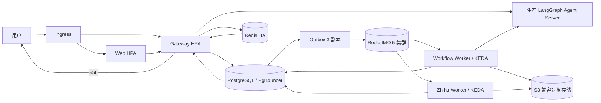

# 高并发第二阶段：生产集群与容量治理

## 1. 本阶段交付

第二阶段把第一阶段的“单机可扩展程序”推进为“可在 Kubernetes 上水平扩展的生产应用”，包含：

- Web、Gateway、Outbox、工作流 Worker、知乎 Worker 按角色独立部署。
- Web/Gateway 使用 HPA，Worker 使用 KEDA 根据 RocketMQ 消费积压扩容。
- PodDisruptionBudget、跨节点分散、资源配额、健康探针和优雅退出。
- PostgreSQL、Redis、RocketMQ、LangGraph Server 作为外部高可用依赖接入。
- 超过阈值的任务结果压缩写入 S3 兼容对象存储，PostgreSQL 保存引用。
- Web、Gateway、Worker 暴露 Prometheus 指标；应用日志默认输出 JSON。
- 生产镜像改为非 root 用户运行，不再把 `.env` 烘焙进镜像。

生产部署清单位于 [`deploy/k8s`](../deploy/k8s)，核心运行时代码位于：

- [`forge/storage/job_result_store.py`](../forge/storage/job_result_store.py)
- [`forge/observability/metrics.py`](../forge/observability/metrics.py)
- [`forge/observability/logging.py`](../forge/observability/logging.py)
- [`forge/async_jobs/worker.py`](../forge/async_jobs/worker.py)

## 2. 请求和任务如何流转



API 只负责认证、限流、写任务和返回 `202`。Outbox 在事务提交后将消息可靠投递到 RocketMQ。Worker 按租约领取任务，完成外部调用后保存结果，数据库提交成功后才 ACK。SSE 事件只是通知，最终状态始终从 PostgreSQL 读取。

## 3. 大结果对象存储

`JobResultStore.persist()` 先把结果序列化为 UTF-8 JSON。结果不超过 `JOB_RESULT_INLINE_MAX_BYTES` 时直接写入 JSONB；超过阈值时压缩上传：

```python
compressed = gzip.compress(raw, compresslevel=6)
digest = hashlib.sha256(raw).hexdigest()
await asyncio.to_thread(
    s3.put_object,
    Bucket=bucket,
    Key=f"workflow-results/{job_id}.json.gz",
    Body=compressed,
    ContentType="application/json",
    ContentEncoding="gzip",
)
```

数据库只保存版本、桶、对象键、原始大小、压缩大小和 SHA-256。读取时会验证存储桶、键前缀、最大大小和摘要，再反序列化 JSON。对象上传或数据库提交失败时，Worker 不会 ACK RocketMQ 消息。

生产环境必须设置：

```text
JOB_RESULT_S3_BUCKET=forge-production-results
JOB_RESULT_S3_PREFIX=workflow-results
JOB_RESULT_S3_ENDPOINT=https://s3.example.com
JOB_RESULT_INLINE_MAX_BYTES=65536
JOB_RESULT_MAX_READ_BYTES=16777216
```

建议给对象桶设置服务端加密、版本控制和生命周期。对象保留时间至少比 `JOB_RETENTION_DAYS` 多一天，用于覆盖数据库清理与失败补偿窗口。数据库提交失败可能留下同键孤儿对象；对象键由 `job_id` 决定，任务重试会覆盖该对象，最终由生命周期规则清理。

## 4. 多副本与扩容策略

### 4.1 API 层

Web 和 Gateway 初始各 3 个 Pod。HPA 以 CPU 为主，并为 Gateway 增加内存指标：

- Gateway：3～30 Pod，CPU 目标 65%，内存目标 75%。
- Web：3～20 Pod，CPU 目标 65%。
- 缩容稳定窗口为 10 分钟，避免流量波动造成反复扩缩。

每个 Pod 运行 1 个 Uvicorn 进程，由 HPA 增加 Pod 数。这样 Prometheus 每次抓取都得到该 Pod 的完整进程指标。应用没有进程内业务真值，多副本共享 PostgreSQL、Redis 和对象存储。SSE 的 Redis 订阅在每个进程内复用，连接由 Ingress 长连接转发。

### 4.2 Worker 层

工作流 Worker 初始 2 个 Pod、上限 100，每个 Pod 并发 4 个任务。知乎 Worker 初始 2 个 Pod、上限 30，每个 Pod 并发 2 个浏览器任务。

KEDA 从 Apache RocketMQ Exporter 的 `rocketmq_message_accumulation` 指标读取积压：

```promql
sum(rocketmq_message_accumulation{
  group="forge-workflow-workers",
  topic="forge-workflow-jobs"
})
```

工作流每积压 20 条消息增加一个目标副本，知乎每积压 4 条增加一个目标副本。KEDA 或 Prometheus 临时故障时启用 fallback 副本数。知乎扩容上限明显低于普通工作流，因为浏览器内存和目标站点限速才是主要约束。

进程内仍执行有界并发：

```python
max_in_flight = concurrency + prefetch
while len(running) >= max_in_flight:
    await asyncio.wait(running, return_when=asyncio.FIRST_COMPLETED)
```

KEDA 决定 Pod 数，`JOB_CONSUMER_CONCURRENCY` 决定单 Pod 并发，两层限制共同防止单个容器无限拉取消息。

## 5. 状态组件高可用要求

Kubernetes 清单不在应用命名空间内搭建状态集群。`forge-secrets` 连接到已经通过故障演练的高可用服务：

| 组件 | 生产要求 | 应用接入点 |
|---|---|---|
| PostgreSQL | 多可用区主备、自动故障转移、PITR、定期恢复演练 | PgBouncer 写入口；任务领取和 Outbox 不走只读副本 |
| Redis | 托管主备或 Sentinel、稳定故障转移端点、持久化策略 | 单一写端点，用于限流、缓存和 Pub/Sub |
| RocketMQ 5 | 多 NameServer、多 Broker、Proxy 多副本、Topic/ConsumerGroup 预创建 | gRPC Proxy 负载均衡地址 |
| 对象存储 | 跨可用区冗余、服务端加密、生命周期、最小权限 | S3 兼容 Endpoint 和专用 Bucket |
| LangGraph | LangSmith Production/Hybrid/Self-hosted Agent Server | `LANGGRAPH_SERVER_URL` |

生产 Compose 已移除 `langgraph dev`，必须显式提供生产 Agent Server URL。生产 Agent Server 使用 PostgreSQL 保存线程、运行与检查点，并用 Redis 处理通信和临时元数据。

连接池按照角色覆盖，避免最大副本数乘以默认池大小压垮 PostgreSQL：API 每进程 3 个连接，Worker 每进程 2 个连接。`PG_STATEMENT_CACHE_SIZE=0` 避免在 PgBouncer transaction pooling 下依赖会话级预编译语句。即使如此，也必须让 `PG_HOST` 指向 PgBouncer，并按所有最大副本数核算数据库连接上限。

## 6. 指标、日志和告警

HTTP 服务暴露 `/metrics`，并使用 `METRICS_BEARER_TOKEN` 限制抓取；Worker 在集群内的 `METRICS_PORT=9100` 暴露指标，NetworkPolicy 只允许 monitoring 命名空间访问。指标标签不包含 `job_id`、`tenant_id` 或 URL 实例值，防止时序基数失控。

| 指标 | 用途 |
|---|---|
| `forge_http_requests_total` | 服务、方法、路由模板、状态码请求量 |
| `forge_http_request_duration_seconds` | API 延迟分布 |
| `forge_job_executions_total` | 成功、失败、租约丢失任务数 |
| `forge_job_execution_duration_seconds` | 工作流/知乎任务耗时 |
| `forge_worker_in_flight_jobs` | 单进程实时执行量 |
| `forge_outbox_publish_total` | Outbox 成功、失败、死信数 |
| `forge_llm_tokens_total` | 按模型、生成/评审角色统计输入输出 Token，用于成本核算 |
| `rocketmq_message_accumulation` | ConsumerGroup 消息积压，也是 KEDA 扩容输入 |

建议第一批告警：API 5xx 比例连续 5 分钟超过 1%；RocketMQ 积压持续增长 10 分钟；Outbox 最老未发布记录超过 60 秒或出现死信；`lease_lost` 持续增加；PostgreSQL/PgBouncer 连接使用率超过 80%；对象存储写入失败；知乎验证码、403、429 比例异常上升。

应用日志默认是一行一个 JSON 对象，至少包含 UTC 时间、级别、服务、logger、消息和异常。生产日志平台应在采集层补充 Kubernetes namespace、pod、node、image digest 和 trace id。

## 7. 部署顺序

前置条件：集群安装 NGINX Ingress、metrics-server、KEDA、Prometheus Operator，并部署 Apache RocketMQ Exporter。外部 PostgreSQL、Redis、RocketMQ、对象存储和 LangGraph Agent Server 已可访问。

1. 构建并推送不可变镜像标签，然后同步修改 `deploy/k8s/base/kustomization.yaml` 和 `deploy/k8s/migration/kustomization.yaml` 的镜像仓库与标签。
2. 修改域名、TLS Secret、Prometheus 地址和 KEDA 查询。
3. 从 `deploy/k8s/secret.example.yaml` 生成真实 Secret；生产环境建议由 External Secrets 或云 Secret Manager 管理，不把 Secret 提交到 Git。
4. 先创建基础资源并执行迁移：

```bash
kubectl apply -f deploy/k8s/base/namespace.yaml
kubectl apply -f deploy/k8s/base/configmap.yaml
kubectl apply -f deploy/k8s/base/service-account.yaml
kubectl apply -f /secure/path/forge-secrets.yaml
kubectl delete job forge-migrate -n forge --ignore-not-found
kubectl apply -k deploy/k8s/migration
kubectl wait --for=condition=complete job/forge-migrate -n forge --timeout=10m
```

5. 再部署应用：

```bash
kubectl apply -k deploy/k8s/base
kubectl rollout status deployment/forge-gateway -n forge
kubectl rollout status deployment/forge-web -n forge
kubectl get hpa,scaledobject,pdb -n forge
```

6. 用灰度流量确认认证、提交、SSE、任务完成、对象结果回读和指标，再逐步放量。

## 8. 十万用户容量结论

这套实现具备承接十万注册用户和大规模在线用户的结构基础，但“十万用户同时发起重型生成或知乎抓取”不能靠当前默认容量直接承接。是否达标取决于到达率、每个任务的 LLM 时长、外部 API 限额、知乎允许速率、数据库写入和预算。

当前默认最大并行能力约为：

- 工作流任务：`100 Pod × 4 = 400` 个进程内执行槽。
- 知乎任务：`30 Pod × 2 = 60` 个浏览器执行槽，但还会受 Redis 全局限速约束。
- API：Gateway 最多 30 Pod，Web 最多 20 Pod，每 Pod 1 个进程。

这里的 400 和 60 是并发槽，不是每秒吞吐。若一个工作流平均持续 5 分钟，400 个槽的理论完成率约为每分钟 80 个；实际值还要扣除外部等待、失败重试和长尾。十万用户在短时间内同时提交会形成队列，系统应保持可用并给出排队状态，但不能承诺即时完成。

上线前必须完成三类压测：

1. API 阶梯压测：认证、提交、查状态、SSE 重连，逐级增加到目标峰值 RPS。
2. 队列恢复压测：预置大批积压，验证 KEDA 扩容速度、最大副本、缩容稳定窗口和 RocketMQ 再投递。
3. 长任务故障压测：Worker 强杀、节点驱逐、PostgreSQL/Redis/RocketMQ 切换、对象存储短暂失败，确认任务不丢失且不会重复产生不可接受的副作用。

验收至少记录 P50/P95/P99、错误率、队列等待时间、任务完成时间、外部 API 限流率、单任务成本、数据库连接峰值、Redis 内存、RocketMQ 积压和对象存储吞吐。只有压测数据满足业务 SLO，才能宣称承接对应的十万用户流量模型。

## 9. 边缘情况

- 对象上传成功但数据库提交失败：同一 `job_id` 重试覆盖对象，生命周期最终清理孤儿。
- 数据库成功但 ACK 失败：RocketMQ 再投递后读取终态并直接 ACK，不重复执行业务。
- Worker 在运行中被驱逐：租约和消息不可见时间到期后由其他 Worker 领取。
- KEDA 读取 Prometheus 失败：使用 fallback 副本，避免 Worker 被错误缩到零。
- 同一会话收到多个操作：PostgreSQL advisory lock 和活动租约保证串行。
- SSE 断开或 Redis Pub/Sub 丢事件：客户端重连后重新读取 PostgreSQL 当前状态。
- 大结果被篡改或截断：大小、桶、前缀或 SHA-256 校验失败，接口不返回损坏 JSON。
- 结果超过 `JOB_RESULT_MAX_READ_BYTES`：上传前终止并进入任务失败/重试流程，避免写入一个永远无法回读的对象。
- 知乎出现 403、429 或验证码：全局限速继续生效，应降低副本或速率并进入人工处置。

## 10. 已覆盖测试

- 小结果保持内联，不调用对象存储。
- 大结果压缩上传并完整回读。
- 大结果缺少 Bucket 配置时明确失败。
- 对象摘要不一致时拒绝反序列化。
- 结果超过读取上限时拒绝上传。
- 普通业务结果含保留字段时不会误判为对象引用。
- Worker 成功提交后 ACK；可重试失败不 ACK；终态重复消息直接 ACK。
- Worker 进程内并发和预取总量不越界。
- Outbox 并发发布、失败重试和死信流程。
- Kubernetes Kustomize 清单能够渲染。
- 生产 Compose 在提供必要环境变量后通过配置校验。
