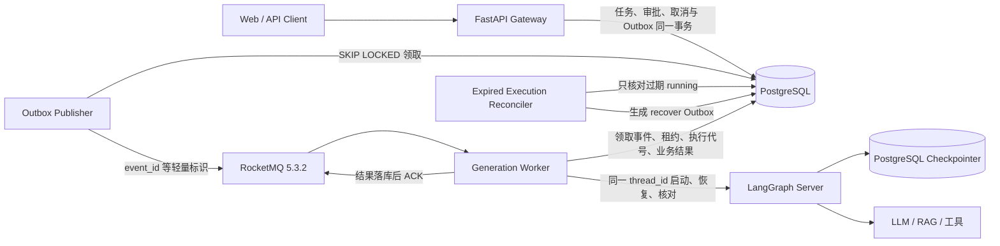
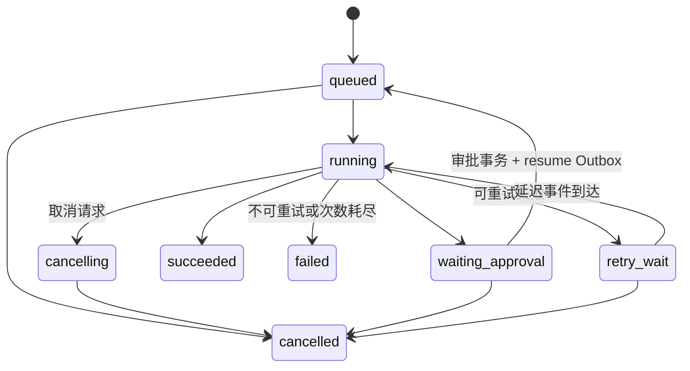

# CoWriter AI 基于 RocketMQ 的文章生成异步调度与故障恢复

本文说明当前已经落地的文章生成异步链路、状态模型、幂等边界、HITL 恢复、故障处理、部署配置和验证结果。实现保留现有 LangGraph、RAG、事实清单、大纲、正文、Critic、Revise 与上下文策略，只把任务调度和执行生命周期移出 HTTP 请求。

## 1. 已核实的运行版本

| 组件 | 当前版本或实现 |
|---|---|
| Python | 容器使用 Python 3.11 |
| LangGraph | `1.2.2` |
| LangGraph SDK | `0.3.15` |
| LangGraph PostgreSQL Checkpointer | `3.1.0` |
| RocketMQ Server | `apache/rocketmq:5.3.2` |
| RocketMQ Python SDK | `rocketmq-python-client==5.1.2` |
| PostgreSQL 驱动 | `asyncpg==0.31.0`、`psycopg==3.3.4` |

RocketMQ Python SDK 5.1.2 使用 gRPC Proxy 和 SimpleConsumer，当前实现实际使用并验证了：生产消息、批量拉取、ACK、修改消息不可见时间、延迟消息时间戳。Broker 侧通过消费组配置最大重试次数和指数退避策略。

## 2. 当前架构



各模块职责如下：

| 模块 | 职责 |
|---|---|
| Gateway API | 鉴权、用户范围授权、请求幂等、任务查询、审批、取消 |
| PostgreSQL | 业务任务、事件、审批、幂等、租约、执行代号、结果引用、Outbox、业务死信 |
| Outbox Publisher | 只扫描未投递 Outbox；Broker 确认后标记完成 |
| RocketMQ | 正常任务与延迟重试事件分发；崩溃窗口中的消息重投 |
| Generation Worker | 一条消息执行一个片段，直到完成或下一个 HITL interrupt |
| LangGraph Server | 执行现有工作流；以稳定 `thread_id` 读写 PostgreSQL Checkpoint |
| Reconciler | 为过期的 `running/cancelling` 执行创建恢复事件，不承担正常任务分发 |

## 3. 数据模型与状态

迁移文件为 `migrations/013_generation_task_reliability.sql`。它扩展了现有 `workflow_jobs`，并新增以下表：

- `workflow_events`：每次启动、审批恢复、重试、故障恢复、取消或受控重放对应一个事件。
- `workflow_approvals`：审批请求、幂等键、`interrupt_id`、`content_version` 和恢复事件关联。
- `workflow_dead_letters`：业务事件耗尽重试或发生不可重试错误后的可追踪记录。
- `workflow_outbox` 扩展字段：`event_id`、`action`、`expected_version`、`delivery_timestamp`。

任务状态和工作流阶段分开保存。任务状态只表示调度生命周期：



`current_stage` 独立记录 `queued`、`running`、`waiting_facts`、`waiting_outline`、`waiting_content`、`completed` 等业务阶段。一个任务从创建到恢复始终使用同一个 `thread_id`。

## 4. API

所有接口都校验当前 JWT 的 `tenant_id` 与 `subject`，用户只能访问和操作自己的任务。

### 创建任务

```http
POST /generation-tasks
Authorization: Bearer <token>
Idempotency-Key: 21b7595f-...
Content-Type: application/json

{
  "article_id": "https://zhuanlan.zhihu.com/p/123",
  "source_article": {"title": "标题", "text": "正文，可留空后抓取"},
  "user_input": "改写成知乎长文",
  "target_platform": "zhihu_article"
}
```

成功后立即返回 `202`：

```json
{
  "task_id": "...",
  "thread_id": "...",
  "status": "queued",
  "deduplicated": false,
  "status_url": "/generation-tasks/..."
}
```

相同用户、相同 `Idempotency-Key` 和相同请求返回原任务；同一个键对应不同请求返回 `409`。

### 查询任务

```http
GET /generation-tasks/{task_id}
Authorization: Bearer <token>
```

返回状态、阶段、修订轮数、待审批数据、`interrupt_id`、`content_version`、结果或最近错误。租约、执行代号等内部隔离字段不会返回。

### 提交审批

```http
POST /generation-tasks/{task_id}/approvals
Authorization: Bearer <token>
Idempotency-Key: approval-...
Content-Type: application/json

{
  "interrupt_id": "...",
  "content_version": "...",
  "decision": "approve",
  "data": {}
}
```

审批记录、任务版本推进、`resume` 事件和 Outbox 在同一事务中提交。重复相同审批只返回原记录；旧 `interrupt_id`、旧内容版本或冲突审批返回 `409`。

### 取消任务

```http
POST /generation-tasks/{task_id}/cancel
Authorization: Bearer <token>
```

排队、等待审批和等待重试的任务直接进入 `cancelled`。正在执行的任务进入 `cancelling`，Worker 在心跳、节点边界和提交结果时检查持久化取消标记。

### 死信查看与重放

```http
GET  /api/admin/generation-dead-letters
POST /api/admin/generation-dead-letters/{dead_letter_id}/replay
```

这两个接口要求 `admin` scope。受控重放创建新事件，但沿用原 `task_id` 和 `thread_id`。Outbox 自身投递失败的死信仍使用已有 `/api/admin/outbox/dead-letters` 接口。

## 5. Transactional Outbox

创建任务时的关键事务逻辑如下：

```python
async with conn.transaction():
    task = await conn.fetchrow("INSERT INTO workflow_jobs (...) RETURNING *", ...)
    await conn.execute("INSERT INTO workflow_events (...) VALUES (...)", ...)
    await self._insert_outbox(
        conn,
        task_id=task_id,
        event_id=event_id,
        thread_id=thread_id,
        action="start",
        expected_version=0,
        topic=ROCKETMQ_GENERATION_TOPIC,
    )
```

Outbox 发布器使用 `FOR UPDATE SKIP LOCKED` 让多个实例并行领取，Broker 发送成功后才写 `published_at`。如果消息已成功但标记失败，记录会再次发送；消费者通过 `event_id`、状态、版本和操作键消除重复影响。

消息体只包含 `event_id`、`task_id`、`thread_id`、`action`、`expected_version`，审批恢复消息再包含 `approval_id` 和 `interrupt_id`。文章正文与工作流历史不进入 MQ。

## 6. Worker、HITL 与 Checkpoint

Worker 的处理顺序已经固定为：

1. 读取并校验消息信封。
2. 查询事件终态；已完成、过期或重复事件直接 ACK。
3. 在 PostgreSQL 事务内锁定事件和任务，校验 `expected_version`。
4. 获取带过期时间的租约并生成新的 `execution_id`。
5. 读取 LangGraph run 和 Checkpoint，决定加入现有 run、补齐业务状态、恢复或启动。
6. 使用 `multitask_strategy="reject"` 与 `durability="sync"` 执行到完成或 HITL 暂停。
7. 使用当前 `execution_id` 提交业务状态和事件完成记录。
8. 只有持久化成功后才 ACK RocketMQ 消息。

核心执行参数：

```python
run = await client.runs.create(
    thread_id,
    assistant_id,
    metadata={"task_id": task_id, "event_id": event_id, "execution_id": execution_id},
    multitask_strategy="reject",
    on_disconnect="continue",
    on_completion="keep",
    durability="sync",
    input=graph_input,       # 首次启动或普通恢复
    # command=Command(resume=approval_payload)  # 审批恢复
)
```

HITL 暂停后，Worker 保存真实 `interrupt_id`、由 Checkpoint ID、interrupt 和审批内容计算出的 `content_version`，把任务改为 `waiting_approval`，然后释放消费者。审批恢复前会再次对照 Checkpoint 中的 `interrupt_id` 和 `content_version`，防止旧审批推进新暂停点。

Checkpoint 的并发保护不只依赖业务表。业务表使用执行代号进行结果 fencing；LangGraph Server 同时使用稳定 `thread_id` 和 `multitask_strategy="reject"`，防止同一 thread 同时创建两个有效 run。恢复时若数据库已有 `active_run_id`，新 Worker 会加入该 run，而不是创建新 run。

## 7. 幂等与并发控制

### 请求幂等

创建任务前先对 `tenant_id + actor_id + Idempotency-Key` 获取事务级 advisory lock，再查询唯一记录。请求使用规范 JSON 的 SHA-256 作为 `request_hash`。

### 审批幂等

审批受两组唯一键保护：

- `task_id + idempotency_key`
- `task_id + interrupt_id + content_version`

任务行使用 `FOR UPDATE` 串行校验和推进。

### 消费幂等

`workflow_events.id` 是消息级幂等键，`task_id + operation_key` 是逻辑操作唯一键。`processing` 只表示持有租约，不能据此 ACK；只有 `completed`、`stale`、`dead_lettered` 或任务终态才可以消化重复消息。

### 旧 Worker 隔离

每次领取生成新的 `execution_id`，所有心跳、run 记录、成功、暂停、失败与取消提交都带这个代号。租约被接管后，旧 Worker 的 SQL 条件不再匹配，返回 `lease_lost`，不能覆盖新执行者结果。

## 8. 重试、超时与取消

错误按下列规则处理：

| 类型 | 行为 |
|---|---|
| 网络超时、429、502、503、504、临时不可用 | 创建延迟 retry 事件，指数退避 |
| 参数错误、权限错误 | 直接失败并写业务死信 |
| HITL interrupt | 正常暂停，不计为失败 |
| Critic 不通过 | 由图内有上限的修订循环处理 |
| Worker 崩溃、ACK 丢失 | MQ 重投和过期执行核对共同恢复 |

应用级最大尝试次数按任务累计，不会因为每次创建新 retry 事件而清零。应用处理完失败事务后会 ACK 原消息，避免与 Broker 重试叠加。Broker 重投主要处理 Worker 崩溃、数据库临时不可用和 ACK 丢失窗口。

执行片段每次领取时刷新 `execution_deadline_at`，因此 HITL 等待时间不会消耗下一段的执行预算。Worker 每隔约三分之一租约周期续期数据库租约和 MQ 不可见时间。`LLM_TIMEOUT` 控制现有 LLM 客户端的单次调用超时；该变量需要同时配置在实际执行图的 LangGraph Server 环境中。

## 9. 故障窗口与恢复结果

| 故障窗口 | 恢复行为 |
|---|---|
| 任务事务已提交，消息未发送 | Outbox 后续扫描补发 |
| 消息发送成功，`published_at` 未写入 | 重复投递，`event_id` 幂等消除副作用 |
| 模型调用中 Worker 崩溃 | run 继续执行；租约过期后 recover 事件加入或核对 run |
| Checkpoint 已完成，业务状态未更新 | 恢复 Worker 读 Checkpoint 后补齐 `succeeded` |
| Checkpoint 已暂停，业务状态未更新 | 补齐 `waiting_approval`、interrupt 和版本 |
| 业务结果已提交，消息未 ACK | 重投后识别事件终态并 ACK |
| 租约过期后旧 Worker 恢复 | `execution_id` fencing 阻止旧结果写入 |
| 取消后模型返回 | 提交前检查 `cancel_requested`，结果不能改成成功 |

Reconciler 只查询租约已过期的 `running/cancelling` 任务，并创建带唯一操作键的 `recover/cancel` 事件和 Outbox。正常排队任务仍完全由 RocketMQ 分发。

## 10. 日志与指标

JSON 日志会附带以下可检索字段：

- `task_id`
- `thread_id`
- `event_id`
- `execution_id`
- `node`
- `attempt`

新增低基数 Prometheus 指标：

- `forge_generation_events_total{action,outcome}`
- `forge_generation_recoveries_total`

现有 HTTP、Outbox、Worker、任务耗时和 LLM Token 指标继续复用。日志不写完整提示词或完整文章。

## 11. 本地启动

1. 从 `.env.example` 创建 `.env`，至少填写 PostgreSQL、JWT、结果对象存储以及生产 LangGraph Server 地址。
2. LangGraph Server 必须连接持久化 PostgreSQL，并加载 `deep_mode_agent`。生产入口 `forge/deep_mode/server_graph.py` 使用 `AsyncPostgresSaver`。
3. 启动服务：

```bash
docker compose -f docker-compose.prod.yml up -d \
  postgres migrate redis rocketmq-namesrv rocketmq rocketmq-init \
  outbox gateway generation-worker
```

`rocketmq-init` 会等待 `DefaultCluster` 中 Broker 真正注册，然后创建普通 Topic、延迟 Topic 和带指数退避策略的消费组。任何校验失败都会使初始化容器失败。

RocketMQ CommitLog 和时间轮使用 Docker 命名卷。Compose 会先运行 `rocketmq-volume-init` 修正卷权限，再启动 Broker。不要在 Windows Docker Desktop 中把 `/home/rocketmq/store` 改回 NTFS bind mount；RocketMQ 的 mmap CommitLog 在该组合下可能写入成功却无法被时间轮回读。

单独启动 Worker：

```bash
ASYNC_SERVICE_ROLE=generation-worker python -m forge.async_jobs.worker
```

Kubernetes 配置位于 `deploy/k8s/base`，已包含 Generation Worker Deployment、PodDisruptionBudget、PodMonitor、NetworkPolicy 和基于 RocketMQ backlog 指标的 KEDA ScaledObject。

## 12. 关键配置

| 变量 | 默认值 | 含义 |
|---|---:|---|
| `GENERATION_WORKER_CONCURRENCY` | 4 | 每个 Generation Worker 的并发片段数 |
| `GENERATION_EVENT_MAX_ATTEMPTS` | 3 | 单任务应用级最大执行尝试数 |
| `GENERATION_TASK_TIMEOUT_SECONDS` | 7200 | 每个执行片段的最长时间 |
| `LLM_TIMEOUT` | 180 | 单次模型调用超时 |
| `JOB_LEASE_SECONDS` | 1800 | 数据库执行租约 |
| `JOB_MESSAGE_INVISIBLE_SECONDS` | 1860 | MQ 消息不可见时间 |
| `GENERATION_RETRY_BASE_SECONDS` | 15 | 应用重试基础退避 |
| `GENERATION_RETRY_MAX_SECONDS` | 300 | 应用重试最大退避 |
| `GENERATION_MAX_REVISION_ROUNDS` | 2 | Critic/Revise 最大修订轮数 |
| `GENERATION_TOKEN_BUDGET` | 0 | 任务 Token 预算记录；0 表示未设置 |
| `GENERATION_RECONCILE_INTERVAL_SECONDS` | 30 | 过期执行核对周期 |

`JOB_MESSAGE_INVISIBLE_SECONDS` 应大于 `JOB_LEASE_SECONDS`。扩容应优先增加 Worker 副本，单 Pod 并发受 LangGraph Server、模型供应商配额和 PostgreSQL 连接池共同约束。

## 13. 已执行验证

已完成以下验证：

- 25 个异步 Worker、Gateway、LangGraph controller、RocketMQ 适配器和 API 单元测试通过。
- 6 个真实 PostgreSQL 集成与故障测试通过，包括并发重复提交、重复/过期审批、取消后的迟到结果、租约接管 fencing、不可重试死信与受控重放、可重试错误耗尽上限。
- 在全新 PostgreSQL 16 容器中从 `001` 到 `013` 的全部迁移成功。
- `kubectl kustomize deploy/k8s/base` 渲染成功。
- `docker compose config` 校验成功。
- RocketMQ 5.3.2 初始化脚本在真实容器中通过。
- `rocketmq-python-client 5.1.2` 在 Compose 网络中完成普通消息生产、消费、解码和 ACK 往返。
- 延迟 Topic 完成真实时间戳投递验证，测试消息约 5 秒后可见并成功 ACK。SDK 5.1.2 的编码器实际要求 Unix 秒，适配层已按该版本行为传值。

## 14. 已知边界

- 外部模型调用不能承诺 Exactly-once。Worker 在模型返回但 Checkpoint 或业务提交前崩溃时，恢复流程可能再次调用模型并产生重复计费。
- `GENERATION_TOKEN_BUDGET` 已进入任务模型和配置，但当前图还没有可靠的逐任务 Token 硬停止机制；现阶段使用执行超时、模型调用上限和最大修订轮数控制成本。
- 结果写入对象存储后、业务事务提交前发生取消或租约丢失，可能留下没有被任务引用的对象；迟到结果不会覆盖取消状态，但对象存储需要生命周期策略清理孤立对象。
- 完整的真实 LLM + RAG + 人工审批端到端测试需要可用的模型凭据、Milvus 数据和独立 LangGraph Server，本次验证没有调用外部付费模型。
- KEDA 查询依赖集群已经采集 RocketMQ Exporter 的 `rocketmq_message_accumulation` 指标；没有该指标时会使用配置的 fallback 副本数。
